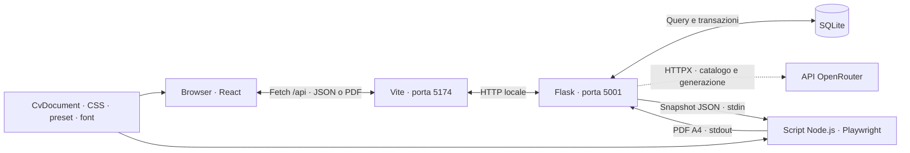

# Guida al codice di CV Copilot

## Ordine di lettura

1. Individua le quattro tabelle e la struttura di una sezione. [schema.sql](backend/schema.sql) · [example_cv.json](backend/example_cv.json)
2. Segui l’apertura di un CV da `CvWorkspace`, che coordina chat, documento e cronologia, fino a `get_cv`. [App.jsx](frontend/src/App.jsx) · [api.js](frontend/src/api.js) · [app.py](backend/app.py) · [cv_service.py](backend/cv_service.py)
3. Leggi un preset. Segui `resolveDesign` e `CvDocument`, poi `updateField`, `changeBlock` e `resize` nell’editor. Per il salvataggio, cerca `saveContent` in React e `save_content`, `require_expected_version` e `insert_version` in Flask. [templates.json](frontend/src/document/templates.json) · [CvDocument.mjs](frontend/src/document/CvDocument.mjs) · [VisualEditor.jsx](frontend/src/document/VisualEditor.jsx)
4. Leggi `useModelCatalog` e `submit` nel frontend. Sul server, `request_review` chiama `generate_review`. Segui poi **Accetta** dalla scheda della proposta fino alla registrazione della versione. [ModelPicker.jsx](frontend/src/components/ModelPicker.jsx) · [ReviewView.jsx](frontend/src/views/ReviewView.jsx) · [llm.py](backend/llm.py) · [ProposalCard.jsx](frontend/src/components/ProposalCard.jsx)
5. Segui `render_cv_pdf`, `renderDocumentHtml` e `generatePdf`, poi `useCvPdf`. [pdf_document.py](backend/pdf_document.py) · [render-pdf.mjs](frontend/render-pdf.mjs) · [PdfPreview.jsx](frontend/src/components/PdfPreview.jsx)
6. Cerca nei test l’accettazione concorrente, il ripristino dello stile, la bozza locale e la conservazione del testo lungo in esportazione. [Test API](backend/tests/test_api.py) · [design](backend/tests/test_design.py) · [PDF](backend/tests/test_pdf.py) · [AI](backend/tests/test_llm.py) · [bozza](frontend/tests/draft.test.mjs) · [editor](frontend/tests/visual-editor.test.mjs)

## Architettura

Vite inoltra `/api` a Flask sia in sviluppo sia in anteprima della build. Flask inizializza il database SQLite di questa installazione e risponde al controllo `GET /api/health`. [Avvio e configurazione](README.md#avvio)

| Modulo | Responsabilità |
| --- | --- |
| `frontend/src/App.jsx` | Mantiene il CV selezionato, la scelta del modello e i dati della richiesta AI per CV. `CvWorkspace` coordina bozza, salvataggi, conflitti, chat e PDF. |
| `frontend/src/api.js` | Invia richieste relative a `/api`, legge JSON o PDF e traduce gli errori HTTP in errori utilizzabili dalla vista. |
| `frontend/src/components/ModelPicker.jsx` | `useModelCatalog` carica i modelli e verifica l’ultima scelta. `ModelPicker` rende il selettore e lo stato del catalogo. |
| `frontend/src/views/ReviewView.jsx` | Mostra conversazione, attribuzione delle risposte e campo di scrittura. Gestisce sezione, annuncio espandibile, scorciatoie da tastiera e invio. |
| `frontend/src/document/DocumentPanel.jsx` | Contiene la barra delle azioni del documento, alterna editor e PDF, apre la galleria e mostra lo stato della bozza. |
| `frontend/src/document/VisualEditor.jsx` e `DesignControls.jsx` | Collegano i campi editabili sulla pagina, le maniglie e i controlli di stile agli aggiornamenti della bozza. |
| `frontend/src/document/CvDocument.mjs`, `document.css` e `templates.json` | Definiscono la struttura, il foglio di stile e i preset condivisi tra editor, miniature e PDF. |
| `frontend/src/document/draft.mjs` e `DraftRecovery.jsx` | Gestiscono Annulla, Ripeti e il recupero esplicito della bozza dopo un aggiornamento. |
| `frontend/src/views/HistoryView.jsx` | Legge e confronta gli snapshot salvati e permette di scegliere una versione da ripristinare. |
| `frontend/src/components/PdfPreview.jsx` | Mostra il PDF nel visualizzatore del browser. `useCvPdf` decide quale snapshot richiedere e gestisce l’URL temporaneo condiviso con il download. |
| `backend/app.py` | Configura Flask, registra route e converte risultati ed errori in risposte HTTP. |
| `backend/cv_service.py` | Legge i documenti, decide quando creare versioni e collega messaggi e proposte ai rispettivi CV. |
| `backend/validation.py` e `backend/design.py` | Controllano struttura JSON, campi, identificativi, lunghezze e risposta del provider. `normalize_design` completa le impostazioni del template e verifica gli intervalli e i riquadri. |
| `backend/db.py` | Apre una connessione per contesto Flask, abilita le chiavi esterne, delimita le transazioni e aggiunge le colonne di attribuzione agli archivi esistenti. |
| `backend/llm.py` | Offre la demo offline oppure legge il catalogo, controlla il modello e interpreta la risposta di OpenRouter via HTTPX. |
| `backend/pdf_document.py` e `frontend/render-pdf.mjs` | Passano a Node lo snapshot temporaneo o salvato, rendono il documento in HTML e restituiscono i byte del PDF stampato da Chromium. |

## Apertura del CV e bozze

`App` conserva l’ultimo ID in `localStorage`. All’avvio legge il CV dal server. Una risposta `404` riporta a **I miei CV**. Il pannello mobile attivo è uno stato React. Il CSS rende visibile il pannello scelto e lascia montati chat e documento.

`CvWorkspace` conserva `draft.content`, `draft.baseContent` e `draft.baseVersion`. La base è la versione aperta all’inizio della modifica. Il contenuto della bozza include sezioni, titolo in pagina e design. `changeDraft` aggiunge lo stato precedente alla cronologia locale. Le battute consecutive sullo stesso campo e gli aggiornamenti dello stesso gesto di ridimensionamento condividono un gruppo. `undoDraft` e `redoDraft` muovono questi stati nella bozza. **Salva** invia la bozza a Flask. `WorkspaceDialog` usa `showModal()` per galleria e cronologia, gestisce Escape e restituisce il focus al pulsante precedente.

## Template, testo e riquadri

- Ogni preset ha `id`, `name`, `family` e una configurazione iniziale. `resolveDesign` combina i valori del preset con quelli dello snapshot. I gruppi `colors`, `typography` e `page` diventano variabili CSS, mentre `blocks` applica eccezioni per ID di sezione. Le famiglie usano classi CSS condivise tra più preset. `sectionColumn` assegna le sezioni alla colonna principale o laterale secondo il layout, il tipo e l’eventuale scelta dell’utente.
- `templateSample` costruisce il CV dimostrativo per la miniatura e `applyTemplate` lo usa per inizializzare la bozza di un CV vuoto. Su un CV compilato cambia la configurazione grafica e conserva il contenuto. Il registro indica anche il trattamento dell’intestazione e l’eventuale posizione e forma del ritratto. [Dati di esempio](frontend/src/document/templateSample.mjs)
- `CvDocument` chiama `renderField` nei punti dedicati a titolo e testo. In modalità **Modifica**, `VisualEditor` inserisce una `textarea` con etichetta accessibile. Il suo contenuto viene replicato in un elemento invisibile che adatta l’altezza alle righe. `updateField` aggiorna solo il campo toccato nella bozza. Gli ID stabili mantengono selezione e riferimenti anche se cambia l’ordine.
- `profile` contiene ruolo, recapiti e l’immagine locale. `subtitle` e `period` appartengono alla singola sezione. `CvDocument` li impagina accanto ai titoli e trasforma le righe puntate in liste HTML. Flask valida i campi facoltativi e li conserva nel JSON della versione. Il contesto della chat omette `profile` e `design`.
- Selezionando una sezione, `VisualEditor` rende le maniglie e le azioni del riquadro. `startResize` misura colonna, riquadro e zoom. `resize` converte lo spostamento in larghezza relativa alla colonna, da 50 a 100%, e altezza minima, da 0 a 140 mm. Il flusso CSS lascia crescere il riquadro con il testo. I campi numerici del pannello offrono gli stessi comandi con tastiera e su mobile.
- Le frecce spostano la sezione tra le vicine nella stessa colonna aggiornando l’ordine di `sections`. Nei documenti a due colonne il pannello Riquadro può cambiare quella di destinazione. La cancellazione rimuove anche le impostazioni legate all’ID. **Ripristina riquadro** elimina solo le eccezioni della sezione. Un cambio di template o **Ripristina stile del template** applica le proprie impostazioni iniziali conservando le sezioni. Il salvataggio valida il risultato e lo versiona con un’unica richiesta.

## Il percorso di Accetta

1. Il pulsante **Accetta** in `ProposalCard` passa la decisione a `CvWorkspace` attraverso `ReviewView`. `api.resolveProposal` invia via Fetch un `POST` a `/api/cvs/{id}/proposals/{proposal_id}/accept`.
2. La route Flask passa gli ID a `resolve_proposal` con `accept=True`. Il servizio usa `BEGIN IMMEDIATE` prima di leggere la proposta.
3. Il servizio legge dalla proposta il CV associato e confronta tale CV con il percorso HTTP. Verifica lo stato `pending` e confronta la versione di base con quella corrente. Recupera la sezione per ID, controlla l’autorizzazione salvata nel messaggio e valida il nuovo testo.
4. Sostituisce solo `section['text']` nella copia in memoria. `insert_version` salva lo snapshot completo, compresi titolo, template e stile, e aggiorna la data del CV. Lo stesso blocco scrive `accepted`, il momento della risoluzione e il numero applicato. Se fallisce una scrittura, il rollback annulla l’intera operazione.
5. Dopo il commit, l’API risponde con stato e numero di versione. React ricarica il CV e la conversazione. La proposta accettata resta consultabile in forma compatta. Se arriva `409`, l’interfaccia aggiorna lo stato e mostra il conflitto. Una bozza aperta resta disponibile per il confronto con la nuova versione.

**Rifiuta** parte dallo stesso servizio e aggiorna solo la proposta. Una proposta obsoleta può essere rifiutata per chiuderla.

## Catalogo e scelta del modello

Il frontend legge modalità e disponibilità della configurazione da `/api/config`. Quando è attivo OpenRouter con chiave presente, legge `/api/models`. Flask mantiene in memoria per dieci minuti il catalogo compatibile con input e output testuali e tool calling. Il browser riceve ID, nomi e l’eventuale predefinito compatibile. La chiave è una variabile del backend. [Riferimento del catalogo OpenRouter](https://openrouter.ai/docs/api/api-reference/models/get-models)

React confronta l’ultimo ID salvato in `localStorage` con il catalogo. Se è ancora disponibile, lo ripristina. Se è stato rimosso, chiede una nuova scelta. In assenza di una scelta precedente, propone il predefinito configurato se compatibile. Il valore del selettore viene acquisito al momento dell’invio e rimane associato alla richiesta di quel CV durante l’attesa.

## Il percorso di una richiesta AI

1. `submit` in `ReviewView` raccoglie domanda, ID della sezione, `expected_version`, annuncio facoltativo e `model_id` se è attivo OpenRouter. Il pulsante **Invia** e la scorciatoia **Invio** usano lo stesso form. `sendReview` in `App` associa la richiesta al CV e `api.sendReview` invia il JSON a Flask.
2. `request_review` legge in una breve transazione la versione corrente, la sezione selezionata e fino a otto messaggi applicativi recenti con stati delle proposte. Verifica che la richiesta si riferisca alla versione corrente. Il contesto del documento include le sezioni e l’eventuale titolo in pagina. Le impostazioni grafiche restano nello snapshot.
3. Fuori dalla transazione, `generate_review` usa il mock deterministico oppure verifica il modello contro il catalogo di OpenRouter e invia una richiesta HTTP con `model`, istruzioni di sistema in italiano, contesto JSON e `tools`. `max_completion_tokens` impone il limite configurato per l’output. Con `tool_choice: auto` il modello può scrivere un chiarimento o restituire una chiamata al tool. [Tool calling di OpenRouter](https://openrouter.ai/docs/guides/features/tool-calling) · [Parametri richiesti al provider](https://openrouter.ai/docs/guides/routing/provider-selection)
4. La chiamata al tool `propose_edit` contiene argomenti JSON con `section_id`, `new_text` e `reason`. Flask li decodifica e `validate_review_result` controlla campi, tipi, limiti e corrispondenza con la sezione selezionata. Tool inattesi, argomenti malformati, più chiamate e risposte troncate generano errori prima del salvataggio. Una proposta valida priva di frase conversazionale riceve il messaggio «Proposta pronta per la revisione». Lo storico passato al modello è composto da messaggi applicativi e relativi esiti.
5. Il servizio verifica di nuovo l’esistenza del CV e scrive i messaggi con l’eventuale proposta in una transazione breve. Salva la versione di partenza e, sull’assistente, `llm_mode`, `requested_model_id` e `actual_model_id`, se presente. La chat mostra l’attribuzione del messaggio salvato. Le risposte simulate riportano **Demo** e le precedenti mantengono i campi a `null`. Se nel frattempo il contenuto è cambiato, la proposta rimane consultabile come obsoleta.

### Errori e tentativi

HTTPX gestisce lo scambio HTTP. Il backend interpreta lo stato della risposta e l’eventuale campo `error` nel JSON, anche con stato `200`, e produce un errore applicativo in italiano. Le categorie includono configurazione mancante, autenticazione, credito insufficiente, limite di richieste, modello indisponibile, timeout, rete e risposta invalida. La domanda rimane nel campo, così l’utente può correggere il problema e riprovare. Ogni invio produce al massimo un `POST` al servizio di generazione. L’accettazione della proposta resta una decisione dell’utente.

## Il percorso del PDF

1. `DocumentPanel` passa a `useCvPdf` il CV salvato e l’eventuale bozza. All’apertura di **Anteprima PDF** e su **Aggiorna anteprima**, l’hook invia il JSON della bozza a `POST /api/cvs/{id}/pdf/preview`. Flask valida `content` e legge il titolo del CV. La route passa lo snapshot temporaneo al renderer senza chiamare il salvataggio. Per una versione salvata l’hook usa `GET /api/cvs/{id}/pdf`.
2. `render_cv_pdf` invia lo snapshot JSON allo script Node tramite standard input. `renderDocumentHtml` richiama `CvDocument` con `renderToStaticMarkup`, incorpora gli stessi CSS e font DejaVu del browser e imposta `@page` in A4. `generatePdf` aspetta `document.fonts.ready` e usa `page.pdf` di Chromium. Selezione, textarea e maniglie appartengono all’editor.
3. `useCvPdf` associa la richiesta alla revisione salvata e al riferimento della bozza catturata all’avvio. Se nel frattempo la bozza cambia, ignora la risposta precedente e mostra **Anteprima da aggiornare**. Il cambio di modalità chiude le richieste in corso con `AbortController` e rilascia il vecchio URL. Il browser genera una sola risorsa `Blob` utilizzata dal visualizzatore e dal download. Il suffisso `- bozza` identifica il file temporaneo.

### Limite della paginazione nell’editor

`VisualEditor` monta una `.cv-page` continua. In `document.css` ha larghezza 210 mm e margini interni. Durante la stampa `@media print` toglie il padding e `@page` applica i margini a ciascun foglio. Chromium decide dove spezzare blocchi, righe e colonne con `break-*`, `widows` e `orphans`. Le dimensioni DOM dell’editor descrivono un flusso continuo e non contengono quei confini di stampa. Anche uno stesso riquadro può proseguire su due fogli.

La soluzione minima usa lo stesso snapshot per l’editor continuo e l’anteprima paginata in sola lettura. Per modificare direttamente su pagine separate servirebbe una rappresentazione dei frammenti effettivi di stampa. `render-pdf.mjs` dovrebbe produrla insieme al PDF e `VisualEditor` e `CvDocument` dovrebbero associare i frammenti alle sezioni editabili, gestendo anche il cursore quando una modifica sposta una riga su un altro foglio. Aggiungere linee a distanza fissa produrrebbe un’indicazione diversa dai confini reali del PDF.

Una prova di questa ricostruzione usa la stessa bozza per il foglio continuo e il PDF. Controlla il testo, l’impaginazione e il download del PDF senza nuove scritture in SQLite. [Registro delle verifiche](docs/ROADMAP.md)

## Versioni e transazioni

- **Versione attesa.** Il client comunica quale versione ha letto. Per esempio, un salvataggio aperto su v2 con v3 già corrente riceve HTTP 409. L’app ricarica il CV e conserva la bozza su v2. Una proposta approvata può far avanzare la versione mentre la bozza è aperta.
- **Recupero.** `compareSavedTexts` confronta versione di partenza, bozza e versione corrente. Se il salvataggio ha cambiato solo il testo, `recoverDraftText` unisce le sezioni aggiornate con i testi manuali e il design. Su una sezione cambiata da entrambe le parti, `DraftRecovery` chiede quale testo tenere. Se è cambiata anche la struttura, il dialogo mostra le due situazioni e offre il recupero esplicito della bozza intera o, per una bozza solo grafica, del design con `copyStyle`. La bozza originale rimane disponibile fino alla scelta. La scrittura nasce dal successivo **Salva**.
- **Snapshot.** Ogni nuova versione conserva tutto il documento. Leggere v2 richiede una sola riga. Il ripristino copia testo e design in una nuova riga e registra la provenienza. Le versioni precedenti senza `design` usano il layout predefinito al momento del rendering. Il design è un campo nel JSON già salvato e la struttura delle tabelle rimane la stessa.
- **Lock e rollback.** Con `autocommit=True`, `db.transaction` invia SQL esplicito. `BEGIN IMMEDIATE` riserva la transazione di scrittura prima dei controlli. `COMMIT` pubblica insieme snapshot e stato. `ROLLBACK` annulla entrambi se l’operazione fallisce. [sqlite3 in Python](https://docs.python.org/3.13/library/sqlite3.html) · [Transazioni SQLite](https://www.sqlite.org/lang_transaction.html)
- **Proposta obsoleta.** Lo stato persistito è `pending`. L’API calcola `obsolete` confrontando `base_version_number` e versione corrente. Il confronto testuale usa lo snapshot di base, così resta leggibile anche dopo altre modifiche.

## Collegamenti con il corso

| Argomento | Punto concreto nel progetto | Riscontro nei materiali locali |
| --- | --- | --- |
| HTML, CSS, DOM ed eventi | Form, etichette e pulsanti, eventi `onSubmit`, `onClick` e `onKeyDown`, layout a pannelli e dialoghi. | `04_HTML_CSS_new2026`, `06_Javascript`, `07_DOM+eventi`. |
| Client-server e HTTP | Il browser usa Vite e Flask. In modalità reale Flask è a sua volta un client HTTP di OpenRouter. | `03_HTTP_new`, `10_Web framework`, `12_API`. |
| AJAX, Fetch e JSON | `api.js` usa Fetch asincrona e legge le risposte come JSON o `Blob`. | `11_Ajax_JSON_Fetch`, `Lab_08_AJAX_e_Fetch_API`. |
| React e stato | Bozza, Undo/Redo, dialoghi e pannello mobile sono stato React. L’ultimo modello è un ID nel browser. Il documento, il design salvato e l’attribuzione delle risposte vivono in SQLite. | `10_Web framework` presenta React con Flask. `13_Gestione Stato` distingue stato volatile e persistente e cita React State. |
| Python, Flask e CRUD | Le route leggono il body, invocano il servizio e rispondono con JSON. | `12_API`, `Lab_07_Flask`. |
| Git | Codice separato dai dati locali tramite `.gitignore`. | Git è nel programma riportato. Le specifiche citano la consegna tramite repository. Una lezione Git dedicata resta da verificare. |

L’integrazione LLM con tool calling, validazione e approvazione umana riprende l’esempio di approfondimento delle specifiche. Gli altri approfondimenti del progetto sono il rendering React condiviso tra editor e stampa, Playwright, le transazioni SQLite e gli snapshot immutabili. La trattazione dettagliata di hook, Vite e libreria di diff resta da verificare nei materiali del corso.

## Dieci domande da orale

1. **Chi risponde a `/api/cvs`?** Vite riceve la richiesta relativa del browser e la inoltra a Flask. La route chiama `cv_service.list_cvs`, che legge SQLite e ritorna i dati in JSON.
2. **Dove sta la bozza?** In React. `draft.mjs` conserva gli stati necessari ad Annulla e Ripeti. **Salva** invia la bozza a Flask per creare una versione persistente.
3. **Come si distinguono due template della stessa famiglia?** Il renderer usa la stessa classe di famiglia e applica la configurazione del preset, per esempio per font, margini, intestazione e colonne.
4. **Come si ridimensiona un riquadro?** `resize` converte i pixel del gesto in percentuale di colonna e millimetri di altezza minima. Lo stile resta associato all’ID della sezione.
5. **Cosa salva SQLite per ogni versione?** `insert_version` salva titolo in pagina, sezioni e design quando presenti nel JSON, oltre all’origine e al numero progressivo.
6. **Come funzionano due accettazioni simultanee?** La prima transazione accetta e crea la nuova versione. La seconda rilegge lo stato e risponde con `proposal_already_resolved`. In caso di errore, il test di rollback verifica che restino lo snapshot e lo stato iniziali.
7. **Cosa succede se il CV cambia durante la chiamata AI?** Il provider viene chiamato fuori dalla transazione. La proposta conserva la versione inviata, diventa obsoleta e l’accettazione restituisce 409.
8. **Perché l’AI lascia intatto il layout?** Il tool contiene ID della sezione, nuovo testo e motivazione. `validate_review_result` controlla gli argomenti. Dopo **Accetta**, `resolve_proposal` sostituisce `section['text']` e registra il documento completo con il design preesistente.
9. **Come si evita di duplicare lo stile tra editor e PDF?** Il browser e `renderDocumentHtml` usano lo stesso `CvDocument`, gli stessi CSS e gli stessi font. A stampare e paginare è Chromium.
10. **Perché anteprima e download mostrano lo stesso PDF?** `useCvPdf` crea un solo Object URL dai byte della bozza corrente o della versione salvata e lo usa per entrambe le azioni.

## Tre esercizi

1. Cambia l’intestazione di un preset in `templates.json`. Applica il preset a un CV sintetico e trova la modifica nella miniatura, nell’editor e nel PDF salvato. Controlla `data-header` in `CvDocument`.
2. Cambia da otto a sei il limite della cronologia inviata all’AI. Usa il test client Flask con un provider simulato per controllare la lunghezza di `context['history']` a chat già avviata. Verifica che la chat mostrata all’utente mantenga tutti i messaggi.
3. Apri lo stesso CV sintetico in due schede. Cambia un colore e il testo di una sezione nella prima. Nella seconda salva il testo di un’altra sezione. Salva dalla prima e osserva il `409`. Usa **Confronta e recupera**, salva e verifica lo snapshot. Ripeti cambiando la stessa sezione per osservare la scelta esplicita. Leggi `compareSavedTexts` e `require_expected_version`.
